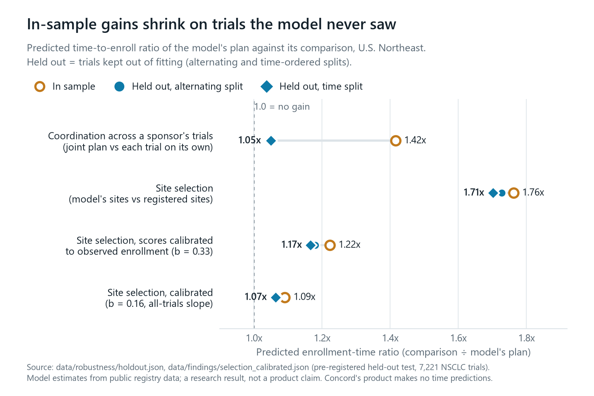
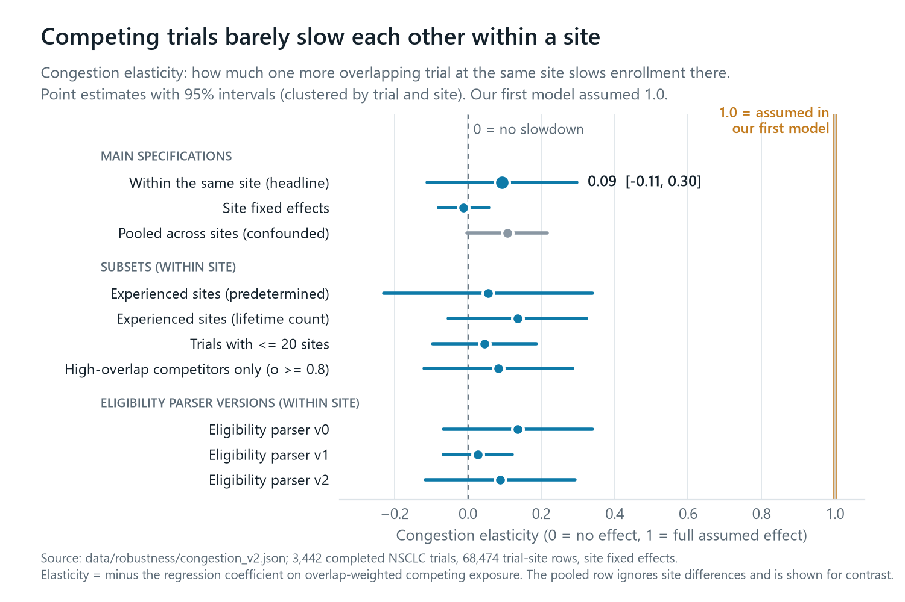
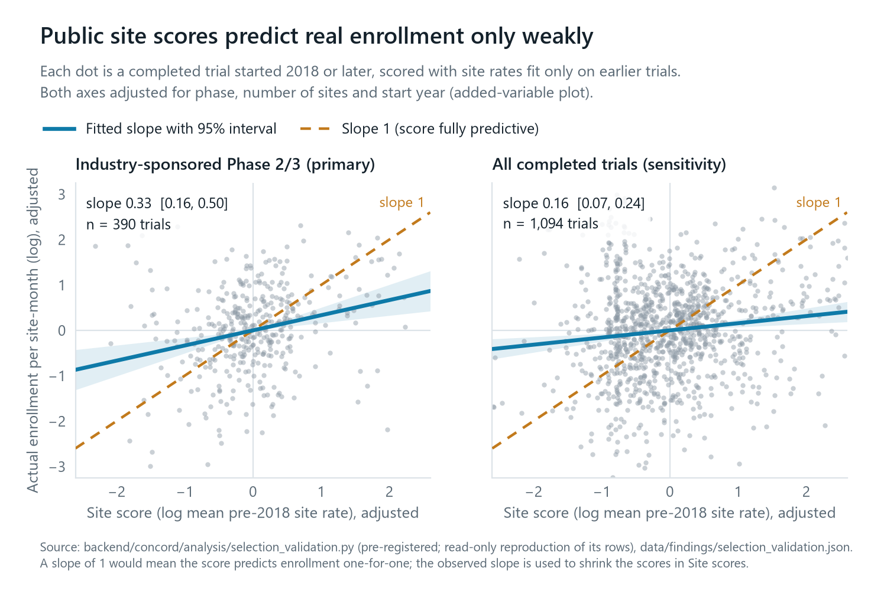
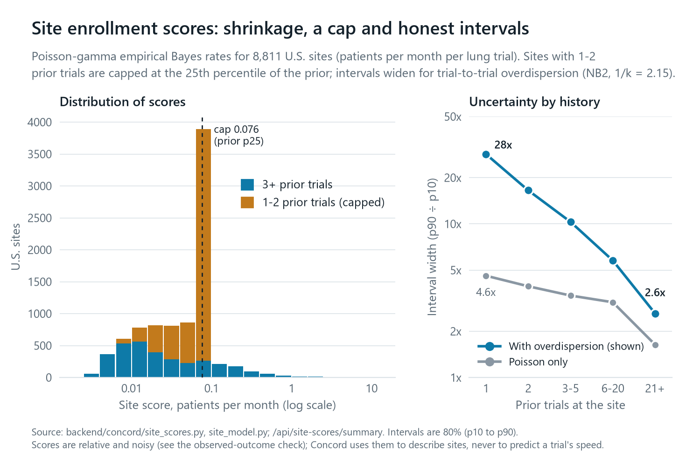
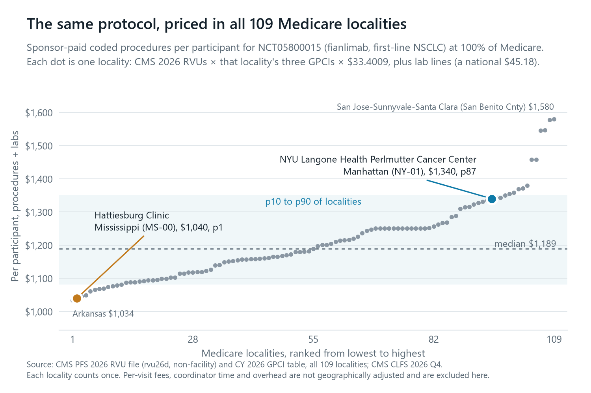
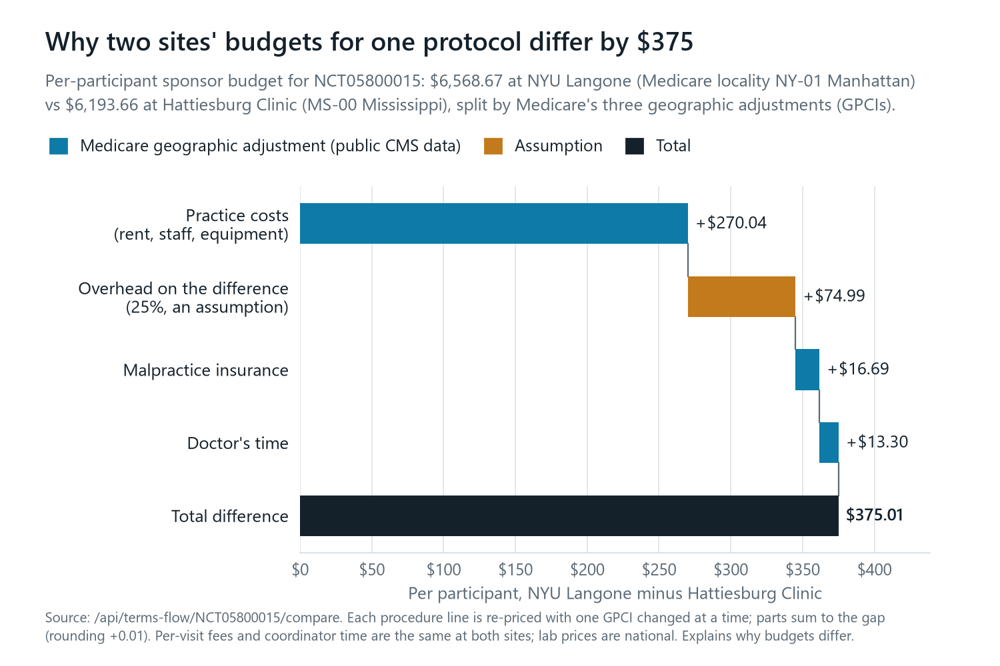
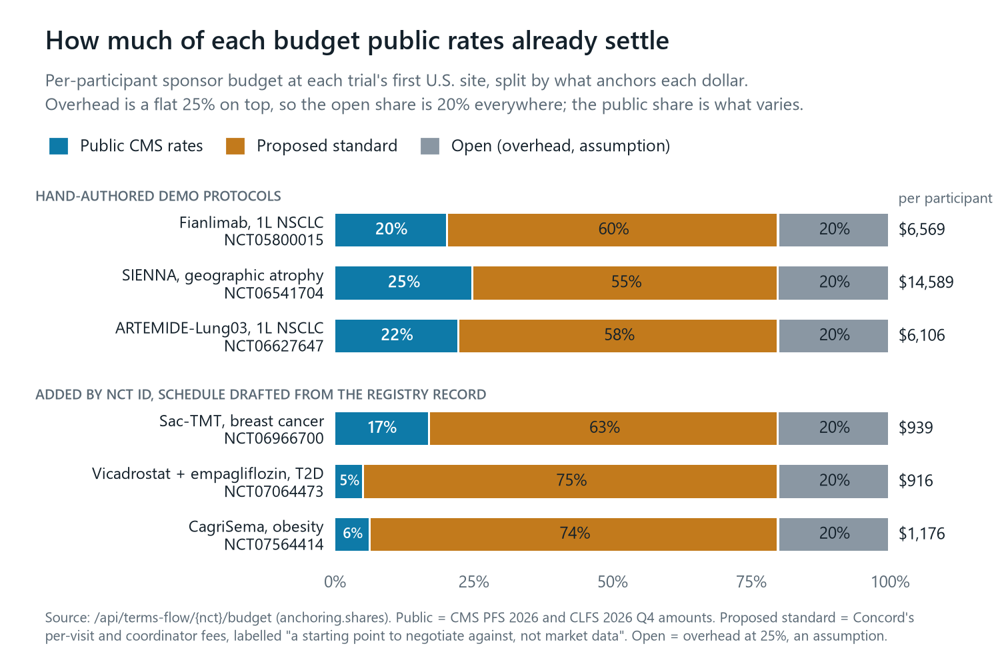

# Figures

Research and pricing figures for the write-up (1500 x 1000 px PNG). Each caption below can be pasted as is.

Regenerate:

```bash
backend/.venv/Scripts/python scripts/figures/export_figure_data.py   # needs data/concord.db and data/ratecard.json
data/work/figenv/Scripts/python scripts/figures/make_figures.py       # any Python with matplotlib
```

The export script reads the committed analysis outputs (`data/robustness/`, `data/findings/`) and the backend modules
directly. Figure 3 reproduces the rows of the pre-registered `selection_validation.py` read-only (the file is not
edited) and checks that its slopes match the published ones (0.334 and 0.158).

## 1. In-sample gains shrink on trials the model never saw



Our first idea was a "clearing house" that coordinates site choices across a sponsor's concurrent trials. In sample,
the joint plan was 1.42x faster than each trial choosing sites on its own. On held-out trials (pre-registered
alternating and time-ordered splits) it fell to 1.05x, essentially no gain. Model-driven site selection held up better
(1.76x in sample, 1.71x held out), but once the site scores are calibrated to how well they actually predict enrollment
(slope b = 0.33, figure 3), the gain is 1.17x, and 1.07x with the all-trials slope. These are model estimates from
public data and a research result, not a product claim: Concord's product makes no time predictions.

## 2. Competing trials barely slow each other within a site



The clearing house assumed that each extra overlapping trial at a site slows that site's enrollment one-for-one
(elasticity 1.0). Regressions on 68,474 trial-site rows from 3,442 completed NSCLC trials, with site fixed effects and
standard errors clustered by trial and site, estimate 0.09 (95% CI -0.11 to 0.30) within the same site. Every subset
and every version of our eligibility parser lands far below 1.0. The pooled estimate (gray) ignores differences between
sites and is shown only for contrast.

## 3. Public site scores predict real enrollment only weakly



An out-of-time check: site enrollment rates are fit only on trials that started before 2018, then used to score the
sites of completed trials that started in 2018 or later. Each dot is one trial; both axes are adjusted for phase,
number of sites and start year (added-variable plot). A perfectly predictive score would follow the dashed slope of 1.
The observed slope is 0.33 (0.16 to 0.50) for industry Phase 2/3 trials and 0.16 (0.07 to 0.24) for all trials. That
slope is what figure 1 uses to calibrate, and it is why Concord stopped forecasting.

## 4. Site enrollment scores: shrinkage, a cap and honest intervals



Each U.S. site's enrollment rate is a Poisson-gamma empirical Bayes estimate: sites with little history are pulled
toward the population prior. Sites with only 1 or 2 prior trials are capped at the prior's 25th percentile (0.076
patients per month), so a single lucky trial cannot make a site look excellent; that is the spike at the cap. The right
panel shows the width of each site's 80% interval. A Poisson-only interval (gray) is too narrow because the same site
enrolls very differently from trial to trial. Adding negative-binomial overdispersion (1/k = 2.15) gives the intervals
Concord shows, from a 28-fold range with one prior trial down to 2.6-fold with 21 or more.

## 5. The same protocol, priced in all 109 Medicare localities



The sponsor-paid procedures for one participant in NCT05800015 (fianlimab, first-line NSCLC), priced at 100% of
Medicare in each of the 109 Medicare localities. Each line is CMS 2026 RVUs times that locality's three geographic
adjustments (GPCIs) times the $33.4009 conversion factor, plus lab lines at the national CLFS amount. The demo's two
sites sit at opposite ends: NYU Langone in Manhattan at the 87th percentile ($1,340), Hattiesburg Clinic in Mississippi
at the 1st ($1,040). The range across the whole country is $1,034 to $1,580.

## 6. Why two sites' budgets for one protocol differ by $375



The full per-participant sponsor budget is $6,568.67 at NYU Langone and $6,193.66 at Hattiesburg Clinic. Concord
re-prices every procedure line with one geographic adjustment changed at a time, so the $375.01 gap splits exactly into
practice costs ($270.04), malpractice insurance ($16.69) and the doctor's time ($13.30), plus 25% overhead on the
difference ($74.99, an assumption). Per-visit fees and coordinator time are the same at both sites. The figure explains
why budgets differ, not which site is cheaper.

## 7. How much of each budget public rates already settle



Concord's anchored share splits each per-participant budget by what anchors each dollar: public CMS rates (physician
fee schedule and clinical lab fee schedule), a labelled proposed standard for fees with no public benchmark (per-visit
and coordinator fees, "a starting point to negotiate against, not market data"), and overhead, which is open to
negotiation and an assumption. On the three hand-authored protocols, public rates settle 20 to 25% of the budget. The
bottom three trials were added by NCT ID, with schedules drafted from the registry record, so their totals cover fewer
procedures.
